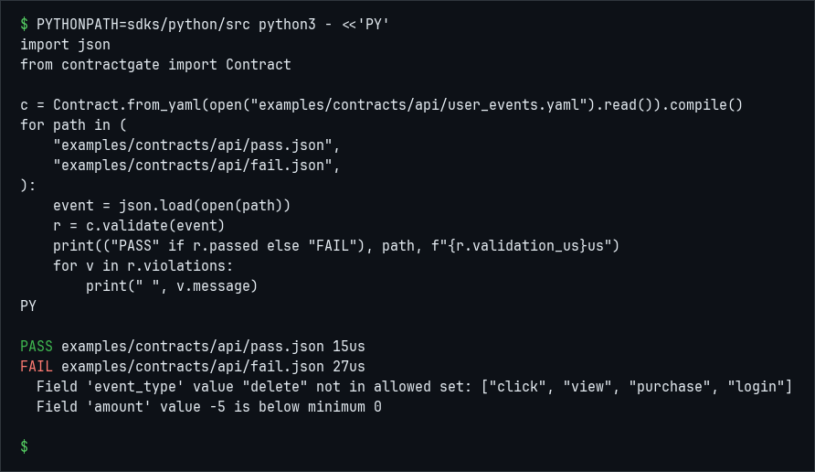

# DataContractGate

**Semantic contracts at every pipeline boundary** — *Patent Pending*

Trust but verify at ingest, between stages, and on egress — before your warehouse, reverse ETL, partners, or AI agents.

## Try it in 10 minutes

You need Docker with Compose, and `make`. No Supabase account. No API keys. No sign-up.

```bash
git clone https://github.com/nightmoose/contractgate.git
cd contractgate
make demo
```

Opens at **http://localhost:3000** — dashboard pre-loaded with three starter
contracts and a live event stream. A cold start (image pulls plus the dashboard
image) took about 1 minute. Later runs reuse the Docker layer cache.

```bash
make demo-reset   # wipe + reseed (clean slate)
make demo-down    # stop and remove volumes
make demo-logs    # follow all service logs
```

> `make demo` runs the real gateway binary with auth off.
> Unlimited local events, full YAML editor, playground, audit log.
> That preview is not the [Self-Hosted Free comparison](#self-hosted-free-vs-cloud).

## Run the demo locally

Everything the demo shows runs on your machine in Docker — no account, no hosted
service, no data leaving your laptop. Two options, depending on what you want to
see:

**1. The full product (dashboard in your browser).** The zero-auth stack boots
the real gateway, Postgres, and the dashboard, pre-seeded with three starter
contracts and a live event stream:

```bash
git clone https://github.com/nightmoose/contractgate.git
cd contractgate
make demo            # docker compose --profile demo up --build
# open http://localhost:3000
```

Prefer a single container? The gateway image is published to GHCR on every
release, so you can run just the API without cloning:

```bash
docker run --rm -p 3001:3001 ghcr.io/nightmoose/contractgate-gateway:latest
# health check: curl http://localhost:3001/health
```

**2. The throughput speed demo.** A self-contained, Kafka-backed demo that races
the real validator against a zero-validation baseline over the same stream, with
a live dashboard at **http://localhost:8088**. This is the local replacement for
the old hosted stream demo:

```bash
docker compose -f docker-compose.kafka-demo.yml up -d   # Redpanda (Kafka)
cargo run --release --features demo --bin demo          # start the demo
# open http://localhost:8088
```

Full walkthrough and tuning knobs: [`demo/README.md`](demo/README.md).



DataContractGate is a high-performance validation gateway that enforces rich semantic data contracts in real time. Built in Rust for sub-millisecond per-event validation (86k+ events/sec/core), it goes far beyond JSON Schema or basic type checks — ontology, glossary, patterns, enums, computed metrics, and automatic inference.

The same contract can gate what **leaves** your system. `POST /egress/{contract_id}` runs the identical engine on any outbound payload — a reverse-ETL row, a notebook export, a state object headed to a decision model. Failing records are blocked, declared PII is masked, and the caller forwards only the returned `payload`. See [`docs/egress-validation-reference.md`](docs/egress-validation-reference.md).

**Validating LLM output?** The same engine powers [AISchemaGate](https://aischemagate.com) (`pip install aischemagate` / `npm install @nightmoose/aischemagate`). One-line wrapper over OpenAI / Anthropic / vLLM / Ollama responses — extracts the structured JSON, validates against your contract, optionally re-prompts on violation. Non-streaming only in v1. See [`docs/llm-output-validation.md`](docs/llm-output-validation.md), [`docs/llm-sdk-reference.md`](docs/llm-sdk-reference.md), and the copy-paste guides in [`docs/integrations/`](docs/integrations/) (Vercel AI SDK, structured outputs, LangGraph). Ingest recipes: [`examples/recipes/`](examples/recipes/).

<!-- LATENCY NOTE (measured 2026-05-24): Per-event validation p99 latency is 31 µs server-side,
     measured with warm compiled-contract cache, leaving ample headroom for transport and
     storage (network + DB). Low-latency by design — Rust + Axum core with zero-copy contract
     matching. See ops/bench/ for the reproducible benchmark. -->

[](https://github.com/nightmoose/contractgate/security)
[](https://github.com/nightmoose/contractgate/security/dependabot)
[](LICENSE)

**See it run** → [Run the demo locally](#run-the-demo-locally) in Docker, or open the [playground](https://app.datacontractgate.com/playground).

---

## Using Claude, Cursor, or Codex? Paste this

```
https://app.datacontractgate.com/llm-integration.md
https://github.com/nightmoose/contractgate

implement this in my repo
```

Your agent reads the [integration playbook](https://app.datacontractgate.com/llm-integration.md)
([source](docs/llm-integration.md)), finds your event shape, infers a contract
from real samples, deploys it, wires your producer to `/v1/ingest`, and verifies
with a dry run before anything is written. Machine index:
[`/llms.txt`](https://app.datacontractgate.com/llms.txt).

MCP (Cursor, Claude Desktop, Windsurf, Copilot, Codex):

```json
{
  "mcpServers": {
    "contractgate": {
      "command": "npx",
      "args": ["-y", "@nightmoose/contractgate-mcp-server"],
      "env": {
        "CONTRACTGATE_API_KEY": "${CONTRACTGATE_API_KEY}"
      }
    }
  }
}
```

Tools and auth: [`docs/mcp-reference.md`](docs/mcp-reference.md).

Claude Code / Cursor plugin:

```
/plugin marketplace add nightmoose/contractgate
/plugin install contractgate@contractgate
```

Redpanda Connect (HTTP processor, no custom plugin): [`docs/examples/redpanda-connect/`](docs/examples/redpanda-connect/).

Zapier — validate the record a Zap just pulled, before the next step writes it. A failure is quarantined and the Zap stops. A pass continues with the payload DataContractGate returned. Setup and the `zapier-platform push` commands: [`docs/zapier.md`](docs/zapier.md). Source: [`zapier/`](zapier/).

---

## Real login (self-host)

Auth on, dashboard sign-up, and every paid feature unlocked. From a fresh clone:

```bash
git clone https://github.com/nightmoose/contractgate.git
cd contractgate
docker compose -f docker-compose.yml -f docker-compose.selfhost.yml up --build
```

Sign up at http://localhost:3000/auth/signup, then sign in at http://localhost:3000/auth/login. Mail is not configured; confirmation is automatic. Do not combine this with `--profile demo`. First boot generates keys and binds ports to `127.0.0.1`. Exact steps: [`docs/self-host-reference.md`](docs/self-host-reference.md).

The comparison table is Self-Hosted Free: real login with `CONTRACTGATE_SELF_HOSTED=true`. The stored plan stays `free` and paid product gates open. SSO and managed hosting stay on hosted Enterprise. `make demo` does not set that flag.

---

## Key Features

- **Semantic YAML Contracts** — entities, types, patterns, enums, required fields, glossary, and computed metrics
- **Real-time Validation** — at ingestion (Kafka, HTTP, batch) with sub-millisecond per-event validation
- **Visual Contract Builder** — intuitive UI + live YAML preview
- **AI-Powered Inference** — paste sample JSON → instantly generates a full contract
- **Quarantine + Replay** — automatically hold and replay violating events
- **Versioned Contracts** — draft → stable → deprecated with compliance mode
- **High Performance** — Rust + Axum core, 86k+ events/sec/core
- **Polyglot** — Rust engine, Python SDK, CLI, Kafka Connect, Zapier, Next.js dashboard

---

## Self-Hosted Free vs Cloud

| Capability | Self-Hosted Free | Cloud Free / Pro / Enterprise |
|---|---|---|
| Validation engine | ✅ Unlimited (local) | ✅ 100K / 25M / Unlimited events/month |
| Contracts | ✅ Unlimited | ✅ 3 / Unlimited / Unlimited |
| Playground | ✅ | ✅ |
| Audit log | ✅ Local Postgres | ✅ 7 / 90 / Custom days retention |
| Live event stream | ✅ | ✅ |
| Auth & API keys | ✅ | ✅ |
| Multi-tenancy | ✅ | ✅ Pro |
| Visual contract builder | ✅ | ✅ Pro |
| AI inference (JSON → YAML) | ✅ | ✅ Pro |
| Quarantine + replay | ✅ | ✅ Pro |
| PII transform rules | ✅ | ✅ Pro |
| Semantic versioning UI | ✅ | ✅ Pro |
| GitHub sync | ✅ | ✅ Pro |
| Team invites & roles | ✅ | ✅ Pro |
| SSO / SAML | ❌ | ✅ Enterprise |
| Managed hosting + SLA | ❌ Self-hosted | ✅ |

[→ Full pricing](https://app.datacontractgate.com/pricing)
[→ Talk to sales](mailto:hello@datacontractgate.com)

---

## Other Quickstarts

**Docker (gateway + Postgres only):**
```bash
docker compose up
```

**Python SDK:**
```bash
pip install contractgate
```
```python
from contractgate import Client
client = Client(base_url="http://localhost:8080", api_key="cg_demo_key")
client.ingest(contract_id="...", events={"user_id": "u1", "event_type": "click"})
```

**CLI:**
```bash
cargo install --git https://github.com/nightmoose/contractgate contractgate
contractgate test --contract examples/contracts/api/user_events.yaml --data examples/contracts/api/pass.json
contractgate test --contract examples/contracts/api/user_events.yaml --data examples/contracts/api/fail.json
```

**GitHub Action** (compile every YAML under `contracts/` on PRs):

```yaml
- uses: nightmoose/contractgate/actions/validate@main
  with:
    path: contracts
```

**pre-commit** (same compile, no network):

```yaml
# .pre-commit-config.yaml
repos:
  - repo: https://github.com/nightmoose/contractgate
    rev: main   # pin to a git sha
    hooks:
      - id: contractgate-validate
```

---

## Architecture

| Layer | Tech |
|---|---|
| Validation engine | Rust + Axum (sub-millisecond per-event, see note) |
| Dashboard | Next.js 15 + TypeScript + Tailwind |
| Storage | Supabase (Postgres + Auth) |
| Connectors | Kafka Connect, HTTP, batch, Python SDK, CLI |
| Observability | Prometheus + Grafana |

**Where to put the gate:** [Trust but verify at every boundary](docs/architecture/where-to-enforce-contracts.md) — ingest, between stages, egress, and AISchemaGate for LLM output, plus Airflow/dbt quarantine-check examples under [`examples/airflow/`](examples/airflow/) and [`examples/dbt/`](examples/dbt/).

Full RFCs and design docs live in [`docs/rfcs/`](docs/rfcs/). For a quick shipped-vs-draft view, see [`docs/STATUS.md`](docs/STATUS.md).

---

## Comparison

| Feature | **DataContractGate** | Great Expectations | Soda | Monte Carlo | dbt |
|---|---|---|---|---|---|
| Validation timing | **At every boundary (ingest + egress)** | After modeling | Mix (mostly after modeling) | Observability | During dbt runs |
| Performance | **Sub-ms per-event, 86k+ ev/s** (Rust, see note) | Python-based | Varies | Not a validator | Not real-time |
| Semantic depth | **Ontology + glossary + metrics** | Basic expectations | Checks + rules | No contracts | Basic schema |
| Visual builder | **Yes + live YAML** | Partial | Limited | No | YAML only |
| Inference from sample data | **One-click JSON → YAML** | Profiler (basic) | Limited | No | No |
| Quarantine + replay | **Built-in** | No | No | No | No |
| Versioning | **Draft → stable → deprecated** | Manual | Basic | No | Basic |
| Self-hosted OSS | **Yes (`make demo`)** | Yes | Open core | Commercial | Yes |
| License | **MIT** | Apache 2.0 | Open core | Commercial | Apache 2.0 |

Keep your Great Expectations, Soda, and dbt tests. They check modeled data after processing. DataContractGate verifies payloads as they cross boundaries — complementary, not either/or.

---

## Contributing

PRs welcome. See [`CONTRIBUTING.md`](CONTRIBUTING.md) and the reference docs in [`docs/`](docs/).

Active RFCs: [`docs/rfcs/`](docs/rfcs/) · RFC status index: [`docs/STATUS.md`](docs/STATUS.md)

---

## License

MIT — see [`LICENSE`](LICENSE). Free to use, fork, and build on top (commercial use welcome).

The semantic contract enforcement algorithm is the subject of a pending patent.
The MIT License governs this code. The patent application covers the enforcement
method as an invention and does not limit anyone's right to use this code under
the MIT License. Questions about patent scope: hello@datacontractgate.com.
See [`NOTICE`](NOTICE).

---

Built with ❤️ in Florida by [NightMoose](https://nightmoose.com)
