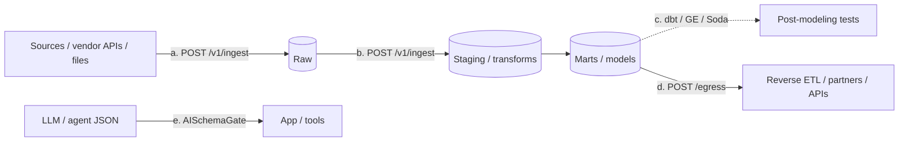

# Trust but verify at every boundary

**Where DataContractGate (and AISchemaGate) sit in a standard data pipeline.**

DataContractGate validates JSON/CSV payloads against YAML contracts via an HTTP
gateway. The same engine can sit at more than one boundary. Post-modeling tools
(dbt tests, Great Expectations, Soda) stay in place — they check modeled data
and transformation logic after processing. DataContractGate checks payloads as
they cross edges. Complementary, not either/or.

## Pipeline map



| Checkpoint | Boundary | Endpoint | What it catches | Fail handling | How the orchestrator learns |
|---|---|---|---|---|---|
| **(a) Ingest** | Source → raw | `POST /v1/ingest/{contract_id}` | Shape/semantics on vendor exports, webhooks, files, SDK events before they land | Default: quarantine (`?on_fail=quarantine`). Or `?on_fail=drop` to count and store nothing. `?dry_run=true` validates without persisting. Optional `X-Batch-Id` (alias `run_id`) stamps quarantine rows for this run. | Cloud: `GET /quarantine/summary?contract_id=&batch_id=`. Self-host: SQL on `quarantine_events.batch_id`. Ingest response also returns per-event `quarantine_id`s. |
| **(b) Between stages** | Raw → staging / transform outputs | Same `POST /v1/ingest/{contract_id}` (or a second contract if the shape changed) | Broken transforms, dropped required fields, enum/range drift between layers | Same as ingest | Same as ingest — filter by the mid-pipeline contract id |
| **(c) Alongside modeling tests** | After models land | *(not DataContractGate)* dbt / GE / Soda | Modeling logic, uniqueness, freshness of tables, business rules on warehouse data | Their own runners | Their own test results. Keep them. |
| **(d) Egress** | Marts → reverse ETL / partners / customer APIs | `POST /egress/{contract_id}` | Outbound rows that no longer match what you promised | Default disposition `block` (failing records omitted from returned `payload`). `?on_fail=quarantine` (default) or `drop`. Forward **only** `response.payload`. Same optional `X-Batch-Id` as ingest. | Same summary/SQL; DB column `direction = 'egress'` |
| **(e) LLM / agent output** | Model → app | AISchemaGate SDKs → same engine (`POST /egress/...` under the hood) | Hallucinated fields, bad enums, missing required keys, PII that should be masked | Bounded auto-repair (optional); otherwise treat like egress | Same account, API keys, quarantine, and dashboard as DataContractGate |

Auth for gateway calls: `X-Api-Key` (same key for ingest, egress, and quarantine list).

## Reject vs quarantine (guidance)

| Mode | When to use | Effect |
|---|---|---|
| **Quarantine** (default) | You want to inspect and replay failures | Failed events written to `quarantine_events` with `status = 'pending'`; not forwarded |
| **Drop** (`?on_fail=drop`) | Hot path where you only need counts | Failure counted; no quarantine row, no body stored |
| **Dry run** (`?dry_run=true`) | CI / first wire-up | Validate only — no audit, quarantine, forward, or metered usage |
| **Egress `disposition=block`** (default) | Outbound gate | Failing records excluded from returned `payload`; caller must forward `payload` only |

Replay (Pro / self-host): `POST /quarantine/replay` with quarantine row ids. See [`docs/quarantine-replay-reference.md`](../quarantine-replay-reference.md).

## Signal back to the orchestrator

Send the pipeline's run id as `X-Batch-Id` on ingest and egress. Then treat `pending > 0` from the summary as a signal that this run held data back.

### Cloud (API)

```
GET /quarantine/summary?contract_id={uuid}&batch_id={run_id}
```

- Auth: `X-Api-Key`
- `batch_id` is the value you sent as `X-Batch-Id`. `run_id` is an alias.
- Response `pending` (and `by_status.pending`) is the count to gate on. `by_direction` splits `ingress` and `egress`. `total` is every status.
- Omit `batch_id` only when you want every source row for the contract, not one run.

`GET /quarantine?contract_id=&batch_id=` still lists the rows. Each row includes `batch_id`.

Full request rules: [`docs/quarantine-batch-reference.md`](../quarantine-batch-reference.md).

### Self-host (SQL)

```sql
SELECT count(*) AS pending_count
FROM quarantine_events
WHERE status = 'pending'
  AND contract_id = ANY (:contract_ids::uuid[])
  AND batch_id = :batch_id
  AND replay_of_quarantine_id IS NULL
  -- optional: AND direction = 'ingress'  -- or 'egress'
;
```

`created_at` in the table is exposed as `quarantined_at` on the API.

### Time window, when the rows have no run id

Calls that omit `X-Batch-Id`, and rows written before migration `049_quarantine_batch_id.sql`, store `batch_id` null. Filter those by:

1. `contract_id` (one contract per checkpoint is clearest)
2. Time window (`quarantined_at` / `created_at` ≥ run start or lookback)
3. `status = 'pending'`
4. `direction` when one contract serves both ingest and egress

`Idempotency-Key` is still not linked to quarantine rows.

Examples:

- dbt (self-host SQL, `invocation_id`, time window as a fallback): [`examples/dbt/`](../../examples/dbt/)
- Airflow (Cloud or self-host API, `run_id`, time window as a fallback): [`examples/airflow/`](../../examples/airflow/)
- Stripe ingest → stage → mart → egress chain (YAML + pass/fail samples): [`examples/contract-chain/stripe/`](../../examples/contract-chain/stripe/). The same four contracts are the public catalog family `stripe-charges-pipeline`.

## Contract families

A family is how DataContractGate records that several contracts are one dataset changing shape. Each member stores:

| Field | Meaning |
|---|---|
| `derived_from` | The previous contract in the chain. Empty on the root. |
| `boundary` | `ingest`, `stage` (between stages — checkpoints (b) above, including a mart you still check with `POST /v1/ingest`), or `egress` |

The public catalog returns that chain on `GET /public-contracts/{slug}` (`family`) and on `GET /public-contract-families/{slug}`. The catalog page links each neighbor. Private orgs use `POST /contract-families` with the same link shape; every contract must belong to the caller's org.

Checkpoint (c) is unchanged: dbt, Great Expectations, and Soda stay on the modeled table. A mart contract in a family does not replace them.

Reference: [`docs/contract-families-reference.md`](../contract-families-reference.md).

## Related docs

- [`docs/v1-ingest-reference.md`](../v1-ingest-reference.md)
- [`docs/egress-validation-reference.md`](../egress-validation-reference.md)
- [`docs/quarantine-replay-reference.md`](../quarantine-replay-reference.md)
- [`docs/quarantine-batch-reference.md`](../quarantine-batch-reference.md)
- [`docs/drop-mode-reference.md`](../drop-mode-reference.md)
- [`docs/llm-output-validation.md`](../llm-output-validation.md) (AISchemaGate)
- [`docs/architecture-overview.md`](../architecture-overview.md)
